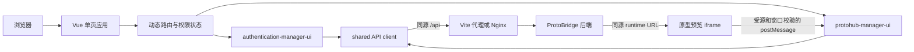

# ProtoBridge

> 面向 Axure HTML 原型交付的项目、版本、预览、Inspect 与分享管理前端，同时提供可复用的企业级系统管理能力。

ProtoBridge 使用 Vue 3、TypeScript 和 Ant Design Vue 构建。它把原型文件从一次性压缩包整理为可管理的项目与版本，并在同一套 Web 界面中完成预览、元素检查、受控分享、用户权限及系统配置。

> [!IMPORTANT]
> 本项目有权授予的原创贡献采用 **Apache-2.0**，允许依条款商业使用、修改和闭源分发；第三方与用户上传内容各自保留权利。参见[许可证与公开发布](#许可证与公开发布前置条件)。

## 目录

- [核心能力](#核心能力)
- [项目状态与边界](#项目状态与边界)
- [界面预览](#界面预览)
- [技术栈](#技术栈)
- [架构与模块](#架构与模块)
- [五分钟启动](#五分钟启动)
- [连接真实后端](#连接真实后端)
- [配置说明](#配置说明)
- [开发与质量检查](#开发与质量检查)
- [构建](#构建)
- [Docker 部署](#docker-部署)
- [Nginx 部署](#nginx-部署)
- [子路径部署](#子路径部署)
- [安全模型与数据边界](#安全模型与数据边界)
- [环境与浏览器支持](#环境与浏览器支持)
- [贡献与问题反馈](#贡献与问题反馈)
- [许可证与公开发布前置条件](#许可证与公开发布前置条件)

## 核心能力

| 领域           | 能力                                                                                                                    |
| -------------- | ----------------------------------------------------------------------------------------------------------------------- |
| 原型项目       | 创建、编辑和删除项目；项目仍有版本时禁止删除，避免误删完整版本链路                                                      |
| 原型版本       | 上传或原位更新 Axure HTML ZIP、维护版本说明与状态、删除版本、打开独立预览                                               |
| 预览与 Inspect | 页面树导航、桌面与窄屏适配、元素属性、CSS、HTML、图片和 SVG 信息查看与复制                                              |
| 原型分享       | 设置描述、可选密码和有效期；展示永久、短期、失效状态以及分享与失效时间；复制或删除分享                                  |
| 登录与个人中心 | 用户名密码登录、服务端可配置的 RSA 加密和验证码、会话恢复、资料编辑、头像裁剪、分步修改密码                             |
| 动态导航       | 服务端菜单驱动路由；顶部一级菜单、左侧二三级菜单；默认页面定位、刷新恢复、中英文显示                                    |
| 身份与权限     | 用户、角色、角色分组、菜单、权限资源、角色成员、按钮权限和数据权限配置                                                  |
| 系统管理       | 基础配置、组织与职位、数据字典、访问日志、系统日志                                                                      |
| 公共交互       | 查询条件、查询历史、分页、表格、表单、加载与错误反馈等共享组件                                                          |
| 工程能力       | Mock 开发、单元/组件/契约/E2E 测试、类型与格式检查、私有 UI 引用/远程资源/依赖精确版本检查、少量敏感信息模式扫描与 SBOM |

## 项目状态与边界

本仓库是 **ProtoBridge 前端**。数据库、原型包解压与存储、分享密码校验、权限最终判定等服务端职责不在本仓库中。

| 状态       | 范围           | 说明                                                                                                   |
| ---------- | -------------- | ------------------------------------------------------------------------------------------------------ |
| 已实现     | 前端页面与交互 | 上述核心能力已有对应页面、状态处理和 API 封装                                                          |
| 已验证     | 本地契约环境   | Mock 流程、请求契约、组件及主要浏览器交互已有自动化测试                                                |
| 待持续联调 | 真实后端       | 后端仍在重构，接口地址保持不变；登录配置、权限树、系统管理写操作、日志及真实原型链路仍需随部署版本复核 |
| 待生产验收 | 部署与运维     | 域名、TLS、反向代理、大文件上传、超时、备份、监控、灰度和回滚需在目标环境验证                          |
| 后续演进   | 新业务能力     | 根据实际需求继续增加，本 README 不承诺未排期功能或交付日期                                             |

本地 Mock 用于前端开发和契约回归，不等同于真实后端联调或生产验收。接口清单与兼容边界见 [API 兼容说明](docs/public/API.md)。

## 界面预览

可通过 `pnpm dev:mock` 查看使用测试夹具的界面。预览工作区提供页面目录、页面切换，以及 Preview 与 Inspect 模式入口。

界面以当前运行版本为准；公开截图应使用可分发的脱敏样本。

## 技术栈

| 类别       | 技术                                                      |
| ---------- | --------------------------------------------------------- |
| 应用框架   | Vue 3.5、TypeScript 5.8、Vite 6.4                         |
| UI 与图标  | Ant Design Vue 4.2、Ant Design Icons Vue                  |
| 状态与路由 | Pinia 3、Vue Router 4                                     |
| 请求与时间 | Axios、Day.js                                             |
| 国际化     | vue-i18n 11                                               |
| 登录加密   | JSEncrypt；是否启用及公钥由服务端登录配置决定             |
| 测试       | Vitest、Vue Test Utils、Playwright                        |
| 质量工具   | vue-tsc、ESLint、Stylelint、Prettier、仓库内扫描脚本      |
| 生产运行   | 静态 `dist/`，可由 Nginx 1.29 容器或宿主机 Nginx 提供服务 |

直接依赖和开发依赖均在 `package.json` 中使用精确版本，并由 `pnpm-lock.yaml` 锁定完整依赖树。

## 架构与模块

### 运行架构



开发环境由 Vite 把 `/api` 转发到后端；生产环境由 Nginx 提供静态文件并反向代理 `/api`。管理接口自动附带令牌和语言请求头，公开分享接口使用独立的无凭据客户端。

### 目录结构

```text
.
├── public/                              # 原样复制到构建产物的静态资源
├── tools/                               # E2E、扫描、SBOM 与工程重命名工具
├── third-party/                         # 第三方许可原文与来源元数据
├── src/
│   ├── app/                             # 应用入口、布局、路由、状态和模块注册
│   ├── modules/
│   │   ├── authentication-manager-ui/  # 登录、个人中心与系统管理
│   │   └── protohub-manager-ui/         # 原型项目、版本、预览和分享
│   └── shared/                          # API、权限、公共组件、组合函数和样式
├── tests/
│   ├── unit/                            # 纯函数与状态单元测试
│   ├── component/                       # Vue 组件测试
│   ├── contract/                        # 请求路径、方法和参数契约测试
│   ├── e2e/                             # Playwright 浏览器流程
│   ├── release/                         # 发行与第三方许可测试
│   └── fixtures/                        # 只用于开发与测试的 Mock 服务
├── docs/                                # 架构、兼容、组件和审查文档
├── Dockerfile
├── docker-entrypoint.sh
├── nginx.conf                           # 容器启动时渲染的 Nginx 模板
├── compose.yaml                         # 环境相关模板，使用前必须调整
└── vite.config.ts
```

模块通过 `src/app/modules/registry.ts` 注册动态菜单入口。业务页面只依赖本模块的 `api`、`types`、`views` 和组件；真正跨模块复用的能力放入 `src/shared`。查询、分页与表单组件的接口见 [组件使用说明](docs/public/DEVELOPMENT.md)。

### 请求路径

| 场景         | 浏览器请求           | 转发行为                                                                   |
| ------------ | -------------------- | -------------------------------------------------------------------------- |
| Mock 开发    | `/api/*`             | Vite Mock 插件在进程内响应，不访问真实后端                                 |
| 真实后端开发 | `/api/*`             | Vite 转发到 `VITE_API_PROXY_TARGET`，默认不改写路径                        |
| Docker       | `/api/*`             | 容器 Nginx 转发到运行时 `API_BASE_PATH`                                    |
| 宿主机 Nginx | `/api/*`             | 由站点配置中的 `proxy_pass` 决定是否保留 `/api` 前缀                       |
| 原型运行时   | 服务端返回的同源 URL | 服务端同源 URL 寻址；sandbox 有效 origin 为 null，postMessage 校验来源窗口 |

## 五分钟启动

### 环境要求

- Node.js `>= 22.12.0`
- pnpm `9.0.6`
- 可用的现代 Chromium 浏览器

获取源码并进入项目根目录后，优先使用 Mock 模式体验完整前端流程：

```bash
corepack enable
corepack prepare pnpm@9.0.6 --activate
pnpm install --frozen-lockfile
pnpm dev:mock
```

打开 <http://127.0.0.1:5173/>，使用以下本地测试账户：

| 用户名   | 密码         | 权限                         |
| -------- | ------------ | ---------------------------- |
| `admin`  | 任意非空内容 | 可执行 Mock 中的查询和写操作 |
| `member` | 任意非空内容 | 只读，用于权限边界检查       |

`wrong` 是 Mock 预留的失败密码。Mock 默认关闭验证码和登录 RSA 加密，其行为定义在 `tests/fixtures/mock-plugin.ts`，不会进入生产构建。

> [!NOTE]
> `pnpm dev:mock` 仅供本地开发和演示。不要把 Mock 模式暴露到公网，也不要将其中的账户理解为生产默认账户。

## 连接真实后端

复制环境变量示例：

```bash
cp .env.example .env.local
```

本地后端默认监听 `127.0.0.1:8080`，可将 `.env.local` 配置为：

```dotenv
VITE_APP_BASE_API=/api
VITE_API_PROXY_TARGET=http://127.0.0.1:8080
VITE_PUBLIC_PATH=/
VITE_TOKEN_KEY=X-Access-Token
VITE_LANGUAGE_HEADER=Accept-Language
VITE_LEGACY_TOKEN_KEY=X-Access-Token
```

然后启动开发服务器：

```bash
pnpm dev
```

Vite 当前不会移除 `/api` 前缀，因此上例中的后端应能处理 `/api/*`。如果后端入口不包含此前缀，应在本地网关中完成统一转换，而不是在业务 API 文件中逐个拼接地址。

前端优先使用以下响应包装：

```json
{
  "success": true,
  "status": 200,
  "result": {},
  "message": "",
  "code": ""
}
```

请求客户端也兼容部分旧接口的裸结果或仅含 `result` 的响应。新接口应保持统一包装，并用正确的 HTTP 状态码表达失败。详细路径、方法和联调关注点见 [API 兼容说明](docs/public/API.md)。

## 配置说明

### 构建时环境变量

| 变量                    | `.env.example` 默认值 | 说明                                                 |
| ----------------------- | --------------------- | ---------------------------------------------------- |
| `VITE_APP_BASE_API`     | `/api`                | 浏览器访问后端的基础路径                             |
| `VITE_API_PROXY_TARGET` | 见 `.env.example`     | 仅用于本地开发服务器的示例代理目标；公开发布前应替换 |
| `VITE_PUBLIC_PATH`      | `/`                   | Vite 构建与 Vue Router 基路径，例如 `/tools/`        |
| `VITE_TOKEN_KEY`        | `X-Access-Token`      | 管理端令牌请求头名称                                 |
| `VITE_LANGUAGE_HEADER`  | `Accept-Language`     | 语言请求头名称                                       |
| `VITE_LEGACY_TOKEN_KEY` | `X-Access-Token`      | 从旧部署迁移自定义令牌存储键时使用                   |

所有 `VITE_*` 变量都会在构建时写入静态资源。生产值变化后必须重新执行 `pnpm build`；不要在这些变量中存放秘密。

### 工程标识

`project.config.json` 管理显示名称、本地存储命名空间和默认镜像名。需要派生新项目时可以运行：

```bash
pnpm rename new-project-name "New Project Name"
```

该命令会修改工程配置、包名、HTML 标题和 README。运行后仍需人工检查 Compose 镜像名、域名、回调地址、品牌资源和后端配置。

### 服务端品牌配置

登录页与管理端会从 `/system/config/front` 读取系统名称、主题、备案信息、版权及品牌图片。服务端没有保存自定义图片时，前端回退到 `authentication-manager-ui/assets` 中的默认 Logo、页签图标和登录背景。

## 开发与质量检查

常用命令均定义在 `package.json`：

```bash
# 开发服务器：连接真实后端
pnpm dev

# 开发服务器：使用仓库内 Mock
pnpm dev:mock

# TypeScript 与 Vue 模板类型检查
pnpm typecheck

# ESLint、Stylelint 与 Prettier 检查
pnpm lint

# 单元、组件与请求契约测试
pnpm test:unit

# 私有 UI 引用、远程资源和常见敏感信息模式扫描
pnpm verify

# 首次运行 E2E 前安装测试使用的 Chrome
pnpm exec playwright install chrome

# 使用独立 Mock 服务运行 Playwright
pnpm test:e2e

# 更新依赖许可清单与 CycloneDX 1.5 SBOM
pnpm sbom
```

`pnpm test:e2e` 会在 <http://127.0.0.1:5187/tools/> 启动独立 Mock 服务，不连接真实后端。失败产物写入 `test-results/`，HTML 报告写入 `playwright-report/`。

`pnpm verify` 是仓库级静态检查，不是完整的安全审计或许可证法律意见。`pnpm build` 生成 `dist/THIRD_PARTY_NOTICES.txt` 与 `dist/third-party-manifest.json` 并随镜像提供，清单是运行依赖解析闭包的上集，不等同实际 bundle 清单。`pnpm sbom` 会更新 `docs/dependency-licenses.json` 和 `docs/sbom.json`，提交前应审阅生成差异和 `UNKNOWN` 许可项。

## 构建

生成生产静态资源：

```bash
pnpm install --frozen-lockfile
pnpm build
```

`pnpm build` 会先执行 `vue-tsc --noEmit`，再由 Vite 生成 `dist/`。生产构建默认关闭 sourcemap。可以在本地检查产物：

```bash
pnpm preview
```

`pnpm preview` 只用于构建结果检查，不应作为生产服务器。

## Docker 部署

仓库中的 `Dockerfile` 是 Nginx 运行时镜像，不包含 Node 构建阶段。构建镜像前必须先生成 `dist/`：

```bash
pnpm install --frozen-lockfile
pnpm build
docker build -t proto-bridge-ui:local .
```

假设后端容器已经以 `proto-bridge-api` 为名称加入 `proto-bridge` 网络，可启动前端：

```bash
docker network inspect proto-bridge >/dev/null 2>&1 || docker network create proto-bridge

docker run -d \
  --name proto-bridge-ui \
  --restart unless-stopped \
  --network proto-bridge \
  -p 10008:80 \
  -e API_BASE_PATH=http://proto-bridge-api:8845/ \
  -e SERVER_NAME=proto.example.com \
  proto-bridge-ui:local
```

替换示例容器名、端口和域名；这里使用配套 Compose 的 `8845`，本地 JAR 默认 `8080`，以实际部署地址为准。`API_BASE_PATH` 必须是 **Nginx 容器能够访问** 的地址；容器中的 `127.0.0.1` 指向容器自身，通常不能访问宿主机或另一个容器。

| 运行时变量      | 必填 | 说明                                                                                                                                           |
| --------------- | ---- | ---------------------------------------------------------------------------------------------------------------------------------------------- |
| `API_BASE_PATH` | 是   | 写入容器 Nginx 的 `proxy_pass`。以 `/` 结尾时，浏览器 `/api/foo` 默认转发为后端 `/foo`；后端需要 `/api/foo` 时可设置为 `http://后端:端口/api/` |
| `SERVER_NAME`   | 否   | 写入 Nginx `server_name` 并启用模板中的 Host 检查；省略时使用本地默认值                                                                        |

验证运行状态：

```bash
docker logs proto-bridge-ui
curl -I -H 'Host: proto.example.com' http://127.0.0.1:10008/
```

`compose.yaml` 默认在本地构建 `proto-bridge-ui:local`，不依赖私有镜像仓库或外部网络。先生成 `dist/`，并填写容器可达的真实后端地址；下面通过 `host.docker.internal` 访问宿主机已发布的后端端口：

```bash
pnpm build
export API_BASE_PATH=http://host.docker.internal:8845/
export SERVER_NAME=proto.example.com
docker compose config --quiet
docker compose up -d --build
```

Compose 提供 `host.docker.internal:host-gateway` 映射；后端位于其他服务器时填写其受控地址，若改用共享 Docker 网络则填写该网络的后端服务名。`API_BASE_PATH` 未设置或为空时，Compose 和入口脚本都会拒绝启动；入口脚本仅接受 HTTP(S) 上游。

`build.sh` 先执行前端构建再构建本地镜像，失败立即停止，不自动推送。需要指定镜像名时可运行 `FRONTEND_IMAGE=proto-bridge-ui:1.0.0 ./build.sh`；Compose 的 `FRONTEND_IMAGE` 可使用同一值。推送由维护者按实际仓库权限另行执行。

生产发布建议使用不可变镜像标签，并保留前一个可运行标签用于回滚。

## Nginx 部署

以下示例把前端部署到站点根路径，并把 `/api/` 转发给同一服务器上的后端。示例中的域名、目录、端口和 `/api` 前缀策略需要按实际环境调整。

```bash
pnpm install --frozen-lockfile
pnpm build
sudo install -d /var/www/proto-bridge-ui
sudo cp -a dist/. /var/www/proto-bridge-ui/
```

创建站点配置：

```nginx
server {
    listen 80;
    server_name proto.example.com;

    root /var/www/proto-bridge-ui;
    index index.html;
    client_max_body_size 500m;

    add_header X-Content-Type-Options "nosniff" always;
    add_header Referrer-Policy "strict-origin-when-cross-origin" always;

    gzip on;
    gzip_types text/plain text/css application/json application/javascript application/xml;

    location / {
        try_files $uri $uri/ /index.html;
    }

    location ^~ /api/ {
        proxy_pass http://127.0.0.1:8845/;
        proxy_http_version 1.1;
        proxy_set_header Host $host;
        proxy_set_header X-Real-IP $remote_addr;
        proxy_set_header X-Forwarded-For $proxy_add_x_forwarded_for;
        proxy_set_header X-Forwarded-Proto $scheme;
        proxy_set_header Upgrade $http_upgrade;
        proxy_set_header Connection "upgrade";
        proxy_buffering off;
        proxy_read_timeout 30m;
        proxy_send_timeout 30m;
    }

    location ~* \.(?:ico|css|js|gif|jpe?g|png|woff2?|eot|ttf|svg|otf)$ {
        try_files $uri =404;
        expires 6M;
        add_header Cache-Control "public";
    }
}
```

上面的 `proxy_pass` 以 `/` 结尾，会移除匹配到的 `/api/` 前缀。后端自身要求 `/api/` 时，将它改为 `http://127.0.0.1:8845/api/`，或者使用符合现有网关规则的地址。

检查并重载 Nginx：

```bash
sudo nginx -t
sudo systemctl reload nginx
```

生产环境应配置 TLS。刷新路由返回 404 时检查 `try_files`；API 返回 502 时检查 Nginx 到后端的网络；上传返回 413 时检查每一层代理的请求体限制。仓库自带 `nginx.conf` 包含容器启动脚本使用的占位符，不应未经渲染直接复制到宿主机 Nginx。

## 子路径部署

部署到 `/tools/` 时，构建基路径、文件目录和 SPA 回退必须保持一致：

```bash
VITE_PUBLIC_PATH=/tools/ pnpm build
sudo install -d /var/www/proto-bridge/tools
sudo cp -a dist/. /var/www/proto-bridge/tools/
```

对应 Nginx 片段：

```nginx
server {
    listen 80;
    server_name proto.example.com;
    root /var/www/proto-bridge;

    location = /tools {
        return 301 /tools/;
    }

    location /tools/ {
        try_files $uri $uri/ /tools/index.html;
    }

    location ^~ /api/ {
        proxy_pass http://127.0.0.1:8845/;
        proxy_http_version 1.1;
        proxy_set_header Host $host;
        proxy_set_header X-Real-IP $remote_addr;
        proxy_set_header X-Forwarded-For $proxy_add_x_forwarded_for;
        proxy_set_header X-Forwarded-Proto $scheme;
        proxy_read_timeout 30m;
        proxy_send_timeout 30m;
        client_max_body_size 500m;
    }
}
```

当前 API 默认仍位于站点根路径 `/api`。如果网关也把 API 放在子路径下，需要同时设置 `VITE_APP_BASE_API` 并修改反向代理规则，然后重新构建。

## 安全模型与数据边界

部署者和二次开发者需要理解以下边界：

- **前端权限不是安全边界。** 菜单、按钮和路由权限用于界面控制，后端必须对每个查询、写入、文件与分享接口执行身份、权限和数据范围校验。
- **令牌保存在浏览器本地存储。** 管理请求通过 `VITE_TOKEN_KEY` 指定的请求头发送，Axios 配置为 `withCredentials: false`。部署环境必须防止 XSS、限制可执行第三方脚本并使用 HTTPS。
- **登录 RSA 不替代 TLS。** 它只按服务端配置加密密码字段，不能保护完整请求、令牌或响应内容。
- **分享 URL 属于敏感信息。** 令牌化链接可能授予原型访问能力；有效期、启用状态和密码必须由后端强制校验。不要在日志、工单或公开页面泄露有效链接。
- **上传的原型是主动内容。** iframe 和后端 CSP 使用 opaque sandbox 隔离，通过校验来源窗口的 `postMessage` 完成模式与 Inspect 通信，原型无法读取管理平台存储/父页面 DOM。复杂 Axure 原生跨 frame 同步可能受限，不能为兼容恢复 `allow-same-origin`；详见[支持边界](docs/public/RELEASE.md)。
- **文件安全由后端最终负责。** 前端限制只能改善交互；后端仍需校验 ZIP 类型与大小、防止路径穿越和压缩炸弹、隔离存储并控制运行时文件访问。
- **前端不保存业务数据。** `dist/` 和前端容器只包含静态资源；项目、版本、分享、用户、日志和文件的备份恢复属于后端与基础设施职责。
- **配置值有不同生命周期。** `VITE_*` 是公开的构建时配置，Docker 的两个变量用于启动时渲染 Nginx；任何密码、私钥或永久凭据都不应放入这些变量或提交到仓库。

仓库内敏感信息扫描只覆盖有限的常见模式。正式公开和生产部署仍需代码审查、依赖漏洞检查、镜像扫描、TLS 与安全响应流程。

## 环境与浏览器支持

| 环境                         | 当前支持边界                                                           |
| ---------------------------- | ---------------------------------------------------------------------- |
| Node.js                      | `>= 22.12.0`                                                           |
| pnpm                         | `9.0.6`                                                                |
| TypeScript 编译目标          | ES2022                                                                 |
| 自动化浏览器                 | Playwright 使用桌面 Chrome；这是当前有明确自动化证据的浏览器           |
| 其他 Chromium 浏览器         | 通常可运行，但应在目标版本上验收                                       |
| Firefox、Safari 与移动浏览器 | 尚未声明完整兼容矩阵；公开发布前应补充目标版本和回归结果               |
| 容器运行时                   | Docker 已验证；其他 OCI 运行时需自行验证，Compose 文件需按环境调整     |
| Web 服务器                   | 能正确处理 Vue Router history 回退、静态资源和 `/api` 反向代理的 Nginx |

浏览器需要支持 ES Modules、`localStorage`、`matchMedia`、`postMessage`、Blob URL 和 Canvas 等现代 Web API。

## 贡献与问题反馈

贡献前请确认有权按 Apache-2.0 提供代码并阅读 [CONTRIBUTING.md](CONTRIBUTING.md)，按以下流程提交变更：

1. 从独立分支开始，保持一次变更只解决一个明确问题。
2. 将业务代码放入所属模块；只有多个模块共同使用的能力才进入 `src/shared`。
3. API 变更同时更新类型、请求契约测试和 `docs/public/API.md`。
4. UI 变更覆盖加载、空数据、失败、无权限和响应式布局；涉及关键流程时增加 Playwright 场景。
5. 提交前至少运行 `pnpm typecheck`、`pnpm lint`、`pnpm test:unit` 和 `pnpm verify`；影响完整流程时再运行 `pnpm test:e2e`。
6. Pull Request 说明问题、行为变化、验证命令、截图，以及后端或部署兼容风险。

公开仓库地址与维护者联系渠道尚未确定。未来 GitHub 仓库启用 Issues 后，问题报告应包含：

- 可复现步骤、期望结果和实际结果；
- 浏览器、Node.js、pnpm 与部署方式；
- 前端版本或提交号，以及相关后端版本；
- 已脱敏的网络错误、请求 ID、控制台信息或截图；
- 是否能在 `pnpm dev:mock` 下复现。

安全问题不应直接公开完整利用细节或有效凭据。公开发布前需要先建立并在 `SECURITY.md` 中公布私密报告渠道和响应范围。

## 许可证与公开发布前置条件

本项目有权授予的原创贡献采用 [Apache License 2.0](LICENSE)，声明见 [NOTICE](NOTICE)。允许依条款商业使用、修改与闭源分发，但须保留适用版权、许可证和 NOTICE、标明修改并遵守专利条款；不授予商标权。第三方依赖遵循各自许可证，不由项目许可证替代。

`private: true` 用于防止误发 npm，可以保留，不影响 GitHub 源码公开。来源、参考实现的可再授权范围和用户内容分发权仍由维护者确认，详见[来源审查](docs/OPEN_SOURCE_REVIEW.md)及[素材说明](docs/ASSET_PROVENANCE.md)。

源码公开使用 `python3 tools/export-source.py` 生成经过 allowlist 选择、模式扫描并附 SHA 清单的目录，不复制整个工作目录。正式构建会随 dist/镜像提供第三方许可全文与清单；具体手动门禁、已知兼容边界和分发义务见[发布指南](docs/public/RELEASE.md)。安全问题通过 [SECURITY.md](SECURITY.md) 指定的私密渠道报告。

## 延伸文档

- [API 兼容与联调清单](docs/public/API.md)
- [公共组件使用说明](docs/public/DEVELOPMENT.md)
- [分组查询使用说明](docs/public/DEVELOPMENT.md)
- [管理端布局决策](docs/public/DEPLOYMENT.md)
- [资源与开源审查](docs/OPEN_SOURCE_REVIEW.md)
